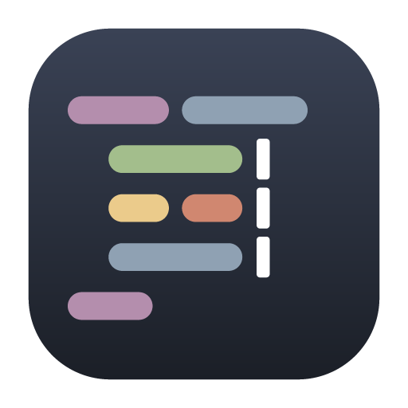

# edit

A fast, native text editor in the spirit of Sublime Text, with the editing features
that make IntelliJ IDEA pleasant: CamelHumps word movement, Extend Selection,
IntelliJ-style multiple carets and column selection, and a side-by-side diff viewer.

Written in Rust ([egui](https://github.com/emilk/egui), [ropey](https://github.com/cessen/ropey),
[syntect](https://github.com/trishume/syntect)); no Java, no JavaScript, no Electron.
Runs on Windows, macOS and Linux.

## Install

Download the latest build from [Releases](https://github.com/lukasz-stec/edit/releases).
A new release is published automatically for every push to `master`.

| Platform | File | Run |
|---|---|---|
| Windows | `edit-windows-x64.zip` | Unzip and run `edit.exe` |
| macOS (Apple Silicon and Intel) | `edit-macos-universal.zip` | Unzip and move `Edit.app` to Applications. The app isn't notarized, so open it the first time with right-click → **Open** |
| Linux (x64) | `edit-linux-x64.tar.gz` | `tar xzf edit-linux-x64.tar.gz && ./edit` (needs GTK 3) |

On macOS you can install and update with [Homebrew](https://brew.sh) instead:
`brew install --cask lukasz-stec/edit/edit`, later `brew upgrade --cask edit`.

Pass files or a folder on the command line: `edit path/to/project path/to/file.rs`.

## Features

- **Fast**: native GPU-rendered UI, rope-based buffers, incremental syntax highlighting
  of 100+ languages; large files stay responsive.
- **Sublime basics**: tabs, a sidebar with one or more folders (File › Add Folder),
  Go to Anything (fuzzy file finder),
  command palette, find/replace with regex, Find in Files across all folders, minimap.
- **IntelliJ editing**: CamelHumps word movement (`Ctrl+←/→` stops inside `camelCase`
  and `snake_case` words), Extend/Shrink Selection, Start New Line, Join Lines,
  Move Line, Toggle Case, clipboard history.
- **Multiple carets and column selection**, following
  [IntelliJ's multicursor](https://www.jetbrains.com/help/idea/multicursor.html):
  Alt+drag rectangles, Column Selection Mode, add/remove occurrences, carets at line ends.
- **Diff viewer** in IntelliJ's style: two panes with synchronized scrolling,
  changed words highlighted, connector bands, `»` to revert a change, `F7` / `Shift+F7`
  to jump between changes. Compare with the saved file, Git HEAD, the clipboard,
  another file or tab, or two files selected in the sidebar.
- **Session restore and hot exit**: open files, carets and scroll positions come back
  on restart, and so do unsaved changes, without asking you to save when quitting.
- **Local History** like IntelliJ: every file version you open, save, or that changes on disk
  is kept for 30 days (compressed, deduplicated, written in the background). Changes are
  grouped into change sets: one Replace in Files, or edits made within a few minutes; files
  that were only opened don't show up. Git commits appear as labels ("Commit: message")
  between the change sets, and you can put your own labels (Local History: Put Label…).
  Compare a change with what came before or with the
  current text, revert single changes, a file, or a whole change set.
- **Git status in the sidebar** like IntelliJ: modified (blue), added (green), untracked (red),
  ignored (olive) and conflicted files; folders show their changes; the branch is in the
  status bar. Refreshed in the background when files or the repository change.
- **Git change markers in the gutter**: added (green), modified (blue) and deleted lines
  against Git HEAD, live as you type; click a marker to see the original lines, roll them
  back, or open the full diff.
- **Markdown editing** (View → Toggle Markdown Editing, or click it in the status bar of a
  `.md` file): Enter continues lists (`-`, `1.` numbered on, `- [ ]` tasks) and `>` quotes,
  Enter on an empty item ends the list, Tab nests an item, typing ```` ``` ```` adds the
  closing fence, `*` `_` `~` wrap a selection, `Ctrl+B` / `Ctrl+I` toggle bold / italic.
  **Smart paste**: a URL pasted over selected text makes a link, an image URL becomes
  ``, copied files become links, and a copied image (a screenshot) is saved to
  `images/` next to the file and linked; image files dropped on the editor are linked too.
  **Live preview** beside the file (`Alt+Shift+M`; follows the editor's scrolling, shows
  local images) and an **outline** of the headings in the sidebar (`Ctrl+F12` to search them).
- **Spell checking** (English): misspelled words get a green wavy underline, in prose files
  (plain text, Markdown) and in comments and strings of code; identifiers, URLs, paths and
  code spans are left alone. `Alt+Enter` on a word lists suggestions and "Add to dictionary"
  (kept in `dictionary.txt` in the settings folder), `F2` / `Shift+F2` jump between problems.
  Toggle it in the View menu.
- **Follows the disk**: the sidebar updates when files are created, deleted or renamed,
  and open files reload when another program changes them (your unsaved edits are
  never overwritten; you get a warning instead).

## Keyboard shortcuts

On macOS, `Cmd` works wherever `Ctrl` is listed.

### Files and navigation

| Shortcut | Action |
|---|---|
| `Ctrl+P`, `Ctrl+Shift+N` | Go to file |
| `Ctrl+Shift+P`, `Ctrl+Shift+A` | Command palette |
| `Ctrl+G` | Go to line |
| `Ctrl+N` / `Ctrl+O` / `Ctrl+Shift+O` | New file / open file / open folder |
| `Ctrl+S` / `Ctrl+Shift+S` / `Ctrl+Alt+S` | Save / save as / save all |
| `Ctrl+F4` | Close tab |
| `Ctrl+Tab`, `Ctrl+PageDown` / `Ctrl+Shift+Tab`, `Ctrl+PageUp` | Next / previous tab |
| `Alt+1` | Toggle sidebar |
| `Ctrl+F` / `Ctrl+H`, `Ctrl+R` | Find / replace |
| `Ctrl+Shift+F` | Find in Files (all sidebar folders; ↑↓ and Enter to open a result) |
| `Ctrl+Shift+R` | Replace in Files (open files are edited unsaved; others are saved, with Undo Replace) |
| `F3` / `Shift+F3` | Next / previous match |
| `Ctrl+M`, `Ctrl+Shift+M` | Go to matching bracket |
| `Ctrl+=` / `Ctrl+-` / `Ctrl+0` | Zoom in / out / reset |

### Editing

| Shortcut | Action |
|---|---|
| `Ctrl+←/→` | Move by word (CamelHumps; toggle in the palette) |
| `Ctrl+W` / `Ctrl+Shift+W` | Extend / shrink selection |
| `Ctrl+L` | Select line |
| `Ctrl+Shift+D` | Duplicate line or selection |
| `Ctrl+Shift+K` | Delete line |
| `Alt+Shift+↑/↓`, `Ctrl+Shift+↑/↓` | Move line up / down |
| `Ctrl+J`, `Ctrl+Shift+J` | Join lines |
| `Shift+Enter`, `Ctrl+Enter` / `Ctrl+Shift+Enter` | Start new line below / above |
| `Ctrl+/` | Toggle comment |
| `Ctrl+]` / `Ctrl+[` | Indent / outdent |
| `Ctrl+Shift+U` | Toggle case |
| `F9` | Sort lines |
| `Ctrl+Shift+V` | Paste from clipboard history |
| `Alt+Enter` | Spelling suggestions for the word at the caret |
| `F2` / `Shift+F2` | Next / previous spelling problem |
| `Ctrl+Z` / `Ctrl+Shift+Z`, `Ctrl+Y` | Undo / redo |

### Multiple carets and column selection

| Shortcut | Action |
|---|---|
| `Alt+J` / `Alt+Shift+J` | Add next occurrence / remove last one |
| `Ctrl+Alt+Shift+J`, `Alt+F3` | Select all occurrences |
| `Ctrl, Ctrl+↑/↓` (press Ctrl twice, hold) | Add caret above / below |
| `Ctrl+Alt+↑/↓` | Add caret above / below |
| `Ctrl+Shift+L` | Split selection into lines |
| `Alt+Shift+G` | Carets at the ends of selected lines |
| `Alt+Shift+Insert` | Toggle Column Selection Mode |
| `Alt`+drag, middle-button drag | Select a rectangle |
| `Ctrl+Alt+Shift`+drag | Add another rectangle |
| `Alt+Shift`+click / drag / double-click | Add or remove a caret / selection / word |
| `Ctrl`+click | Add a caret |
| `Esc` | Back to a single caret |

### Diff

| Shortcut | Action |
|---|---|
| `Ctrl+D` | Show diff: two files selected in the sidebar, else unsaved changes, else Git HEAD |
| `F7` / `Shift+F7` | Next / previous change |
| `Alt+Shift+H` | Local History window for the current file (right-click a file or folder in the sidebar for its history); compare a version with the current text or with the version before it, revert, restore deleted files |
| Ctrl+click two files in the sidebar, right-click | Compare selected files |

More comparisons (clipboard, another file, another tab) are in the **Diff** menu.

## Settings and data

Session, hot-exit backups and your own syntaxes and themes live in:

- Windows: `%APPDATA%\edit`
- macOS: `~/Library/Application Support/edit`
- Linux: `$XDG_CONFIG_HOME/edit` or `~/.config/edit`

Drop Sublime `.sublime-syntax` files into `syntaxes/` and `.tmTheme` files into
`themes/` there to add languages and color schemes. Words you add to the spelling
dictionary are in `dictionary.txt` (one per line). The built-in English dictionary is the
SCOWL-based en_US Hunspell dictionary ([license](assets/dict/LICENSE)).

## Building from source

Install Rust from [rustup.rs](https://rustup.rs) (on Windows, with the MSVC build tools), then:

```sh
cargo build --release      # binary in target/release/
cargo test
cargo run --example mkicon  # regenerate assets/icon.* after changing src/icon.rs
```

On Linux, install the GTK 3 and xkbcommon development packages first
(`sudo apt install libgtk-3-dev libxkbcommon-dev` on Debian/Ubuntu).

## Releases

`.github/workflows/release.yml` builds and tests on Windows, macOS and Linux for every
push to `master` and publishes a release tagged `v<major>.<minor>.<run number>`
(major.minor come from `Cargo.toml`). Add `[skip ci]` to a commit message to push
without releasing, or start a build by hand from the **Actions** tab.
